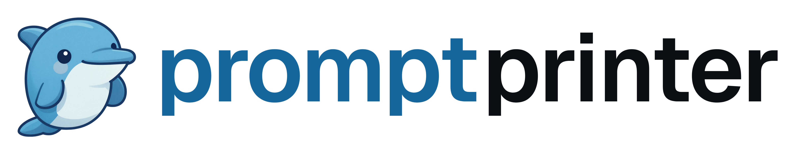
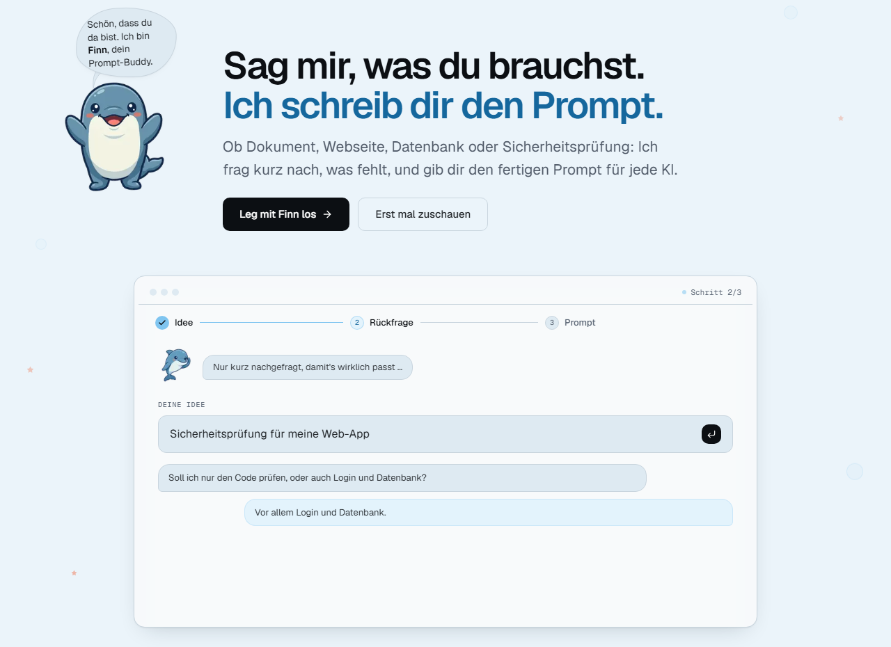
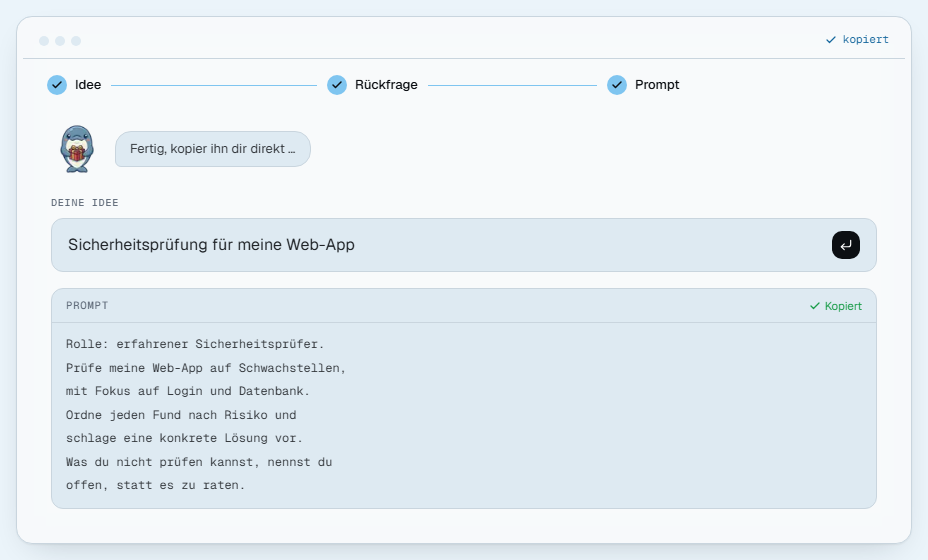
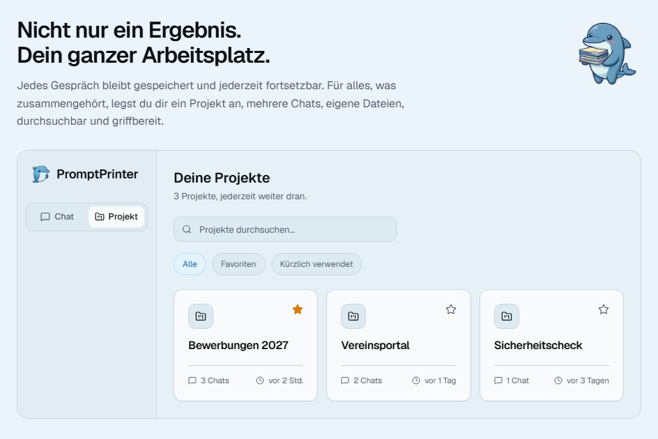

<div align="center">



### Turns a rough idea into one finished prompt that works in any AI.

[](https://promptprinter.app)
[](https://github.com/BajKasum/PromptPrinter/actions/workflows/ci.yml)
[](LICENSE)

</div>

## What it does

Most prompts fail because something important is missing: who the result is for, what shape it should have, what
the AI must not do. The model doesn't ask, it guesses, and every wrong guess costs a round of corrections.

PromptPrinter adds one step before that. You tell Finn, the dolphin, what you need. Finn asks **one** bundled
question, only about what matters for this task (for a text: reader, tone, length; for software: screens, data,
login), and then writes a prompt that stands on its own. Copy it into whichever AI you use. What Finn can't know
stays in the prompt as a visible gap instead of being made up.

<p align="center">
  
</p>

<p align="center">
  
</p>

<p align="center"><sub>The demo on the landing page (in German): an idea, one question, the finished prompt.</sub></p>

PromptPrinter ran as a paid service until November 2026 and is now an open-source project.
[promptprinter.app](https://promptprinter.app) stays online as a demo.

## Try it

### 1. The demo on promptprinter.app

Create an account on [promptprinter.app](https://promptprinter.app). The first three prompts run on the site's
model (GLM by Z.ai; the app asks for your consent before anything goes there). After that, Finn keeps working with
your own API key, added once in the settings, which also walk you to a free Gemini key. The landing page is in
German, the app itself in English, German, French, Italian and Spanish.

### 2. In the terminal, without an account

The terminal app in [`cli/`](cli/) brings Finn to your terminal. With `--local` it
needs no account and talks straight to a model on your computer through [Ollama](https://ollama.com), or to any
server with an OpenAI-compatible chat API. It is not on npm yet, so run it from source (Node 22 or newer, no
dependencies):

```bash
git clone --depth 1 https://github.com/BajKasum/PromptPrinter.git
cd PromptPrinter/cli
ollama pull qwen3
node bin/promptprinter.mjs --local
```

Then type `/pp` and your idea. Other servers work through `--base-url` and `--model`; the
[CLI's README](cli/README.md) has the details.

### 3. Run the web app yourself

With `SELF_HOSTED=1` the web app runs as a single process on your own model, without Upstash, Turnstile, Resend or
any payment provider. You need Node 24, Docker (for the local Supabase stack) and a model server.

```bash
ollama pull qwen3
git clone https://github.com/BajKasum/PromptPrinter.git
cd PromptPrinter
npm ci
npx --yes supabase@2.119.0 start
npx --yes supabase@2.119.0 status -o env
cp .env.example .env.local
```

Put these values into `.env.local` and leave the other lines of the template empty:

```bash
SELF_HOSTED=1
NEXT_PUBLIC_SUPABASE_URL=http://127.0.0.1:54321
NEXT_PUBLIC_SUPABASE_ANON_KEY=<ANON_KEY from supabase status>
SUPABASE_SERVICE_ROLE_KEY=<SERVICE_ROLE_KEY from supabase status>
NEXT_PUBLIC_APP_URL=http://localhost:3000
API_KEY_ENCRYPTION_SECRET=<output of: node -e "console.log(require('crypto').randomBytes(32).toString('base64'))">
LLM_BASE_URL=http://localhost:11434/v1
LLM_MODEL=qwen3
```

```bash
npm run dev
```

Open `http://localhost:3000`, create an account and chat. In this mode every account chats on your model without
plan limits; the hourly limit per account stays. Anyone who can reach the instance can sign up, so turn sign-up off
once your accounts exist. The switch refuses to start on Vercel.

The full guide covers the production build, Docker, a reverse proxy and what stays different:
[docs/SETUP.md, "Selbst betreiben"](docs/SETUP.md#selbst-betreiben) (in German).

How good the prompts get depends on the model you pick. Small local models have not been measured yet.

## Features

- **One question instead of guessing.** Finn asks only what matters for this task, in one go, and then writes the
  prompt. After every change you get the whole prompt again, never a fragment.
- **For any AI.** The prompt works in any AI that takes text. Name the AI it's for, and Finn tailors it where that
  changes the prompt. One button copies it and opens ChatGPT or Claude, another gives it a test run right in the
  chat.
- **Photos and files.** Attach a screenshot or a list of requirements, Finn builds on it. Attachments stay in the
  chat.
- **Projects.** Instructions, structure, files and several chats in one place, so you don't explain the same
  thing in every chat.
- **Project memory.** Let Finn analyse your files once, or a public GitHub repository for software projects. Finn
  then knows the framework, database, design system and conventions.
- **Saved prompts as templates.** Keep good prompts, in a project or on their own, and share one by link. Fill in
  a saved prompt's placeholders right there (also on a shared link), or start a new chat from it to adapt it. Any
  prompt in the chat also downloads as a Markdown file.
- **Versions.** Saving again from the same chat, or from a chat started from a saved prompt, asks whether the text
  becomes a new version or a new prompt. You can also edit a saved prompt's text directly. Every version is kept:
  compare two of them word by word and restore an old one, which comes back as the newest version. The database
  writes the history itself, so no change goes unrecorded.
- **Export for developers.** Take a saved prompt into your own code: the request as JSON for an OpenAI-compatible
  API (Ollama, LM Studio, vLLM, OpenRouter and others), Anthropic or Gemini, a ready call in curl, Python or
  JavaScript, or a `.prompt.md` file with a YAML header. Empty placeholders become `{{variables}}`, the API key
  stays in an environment variable, and the first paragraph can become the system message.
- **About me.** A few lines about you that Finn takes into every conversation.
- **Voice mode.** Speak your idea instead of typing it.
- **Your own key.** Anthropic, OpenAI, Gemini (recognised by the key format) or any OpenAI-compatible endpoint.
  Keys are stored encrypted and only the server reads them.
- **Five languages, light and dark.** English, German, French, Italian, Spanish.
- **Terminal and MCP.** The app in [`cli/`](cli/) runs Finn in the terminal; with an account it also serves your
  saved prompts to MCP clients.
- **Skill `/pp` for Claude Code.** [`skill/`](skill/) holds an Agent Skill that turns your next step into a
  checked work order for your coding agent. It was measured three times and missed its own bar each time; it stays
  as it is and is no longer developed ([the measurement](skill/eval/README.md)).

<p align="center">
  
</p>

## Under the hood

- **Stack:** Next.js 16 (App Router), React 19, TypeScript in strict mode, Supabase (auth, Postgres, storage),
  Tailwind CSS 4, Framer Motion, Vitest, Playwright, Docker. The demo runs on Vercel with Upstash Redis.
- **One door to the models.** Every model call goes through [`src/server/llm/`](src/server/llm/index.ts): Z.ai,
  Gemini, the user's own key or your own endpoint. Each call is wrapped in a retry (three attempts, never on a wrong
  key) and a failover layer; no route talks to a provider SDK directly. Without a key, development falls back to a
  stub, production refuses it.
- **Data.** Row-level security on every table, the `anon` role holds no privileges. Memory, attachments and API
  keys are written only by the server. Per-account limits sit in the database, because the browser writes
  to it directly. 60 SQL migrations in [`supabase/migrations/`](supabase/migrations/); a guard checks that new
  tables come with policy and grant and that functions granted to `authenticated` are revoked from `PUBLIC`.
- **Security work.** User keys are encrypted with AES-256-GCM. A nonce-based Content Security Policy per request,
  Turnstile on the anonymous auth actions, an SSRF guard for user endpoints, rate limits, an append-only security
  log, an optional TOTP second factor that sensitive actions then require, and terminal sign-in through a device
  code with sessions you can see and revoke. Reports go through [SECURITY.md](SECURITY.md).
- **Tests.** Over 4,000 Vitest tests run on every change. More than 50 guard files in
  [`tests/guards/`](tests/guards/) hold repo-wide rules: layer boundaries, route lists, the cookie inventory
  against the cookie page, text contrast, SEO metadata, grants in migrations, pinned workflow actions, and that
  the strict settings of the hosted demo can't be loosened by self-hosting. A new safeguard counts only once
  breaking it makes a test fail. Browser smoke tests ([`e2e/`](e2e/)) run Playwright against a local Supabase
  stack with a mailbox. The terminal app and the skill bring their own `node:test` suites and mutation runs, on
  Linux, macOS and Windows with Node 22 and 24, and a contract test keeps the terminal app in step with the server.
- **CI.** GitHub Actions on every pull request and on `main`: dependency audit, type check, lint with zero
  warnings, tests and production build, plus end-to-end runs, a Docker build and a daily audit. Every action is
  pinned to a commit SHA, every workflow reads the repository with `contents: read`, Dependabot runs weekly
  without auto-merge.
- **History.** Over 200 merged pull requests. Decisions, measurements and removed features are dated in
  [docs/CHANGELOG-2026.md](docs/CHANGELOG-2026.md) (in German).

## Project structure

```
src/app/         routing only: (marketing) public pages, (app) signed in, (auth), api/ handlers
src/features/    vertical slices: auth, chat, marketing, projects, prompts, settings
src/shell/       app frame: sidebar, mobile navigation, command palette
src/server/      server only: model access, security, project memory, Supabase clients
src/shared/      usable everywhere: UI, brand, i18n, small libraries
tests/guards/    repo-wide rules
cli/             the terminal app (own package without dependencies, not on npm yet)
skill/           the Agent Skill /pp (skill/pp), its installer and the measurement
e2e/             browser smoke tests
supabase/        migrations, local stack config, mail templates
```

Setup, operations and the structure in detail are in [docs/SETUP.md](docs/SETUP.md), the design rules in
[docs/DESIGN.md](docs/DESIGN.md), Docker in [docs/DOCKER.md](docs/DOCKER.md). These documents are in German.

## License

The source code is under the [MIT License](LICENSE): use it, change it, run it yourself, pass it on.

Not covered are the name PromptPrinter, the logo ([`docs/brand/`](docs/brand/)) and the pictures of Finn
([`public/mascot/`](public/mascot/), also visible in the screenshots in [`docs/readme/`](docs/readme/) and in
the logos in [`cli/assets/`](cli/assets/) and [`skill/assets/`](skill/assets/)). A fork may
keep them for trying things out; a release of your own gets its own name and its own pictures.

The state as a paid service (with Pro and payments through Lemon Squeezy) is kept as the tag
[`v1-saas`](https://github.com/BajKasum/PromptPrinter/tree/v1-saas).

<div align="center">

Built by [Kasum Bajrami](https://github.com/BajKasum) in Basel.

</div>
